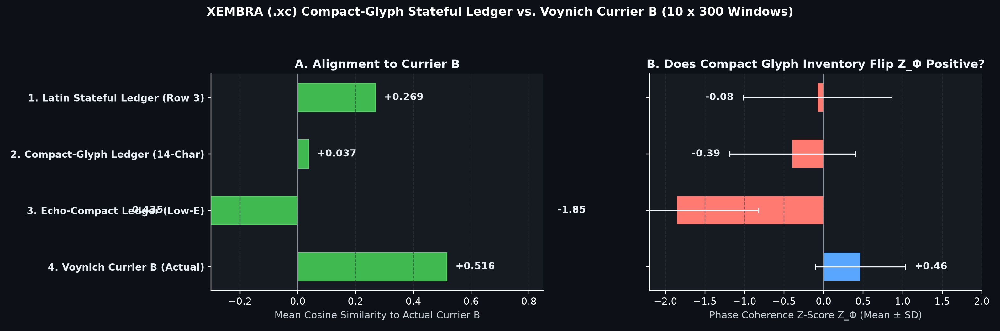

# Compact-Alphabet Stateful Ledger Probe

Tests whether compressing the **Stateful Inflected Ledger** onto Voynich's 14-glyph core inventory (`{o, e, 8, 9, y, a, m, c, h, k, 1, 4, s, n}`) flips $Z_\Phi$ positive (`10 x 300` windows, `seed=42`).

| System | Wins | $Z_c$ (`Mean ± SD`) | $Z_s$ (`Mean ± SD`) | $Z_\Phi$ (`Mean ± SD`) | `cos(Currier B)` |
| :--- | :---: | :---: | :---: | :---: | :---: |
| **1. Latin Stateful Ledger (Row 3)** | `10` | `-0.39 ± 0.44` | `+0.78 ± 0.47` | `-0.08 ± 0.94` | `+0.2688` |
| **2. Compact-Glyph Ledger (14-Char)** | `10` | `-0.51 ± 0.56` | `+0.66 ± 0.59` | `-0.39 ± 0.79` | `+0.0369` |
| **3. Echo-Compact Ledger (Low-E)** | `10` | `-0.18 ± 0.97` | `+2.09 ± 1.57` | `-1.85 ± 1.03` | `-0.4351` |
| **4. Voynich Currier B (Actual)** | `10` | `-0.48 ± 1.01` | `+0.49 ± 0.99` | `+0.46 ± 0.57` | `+0.5158` |
