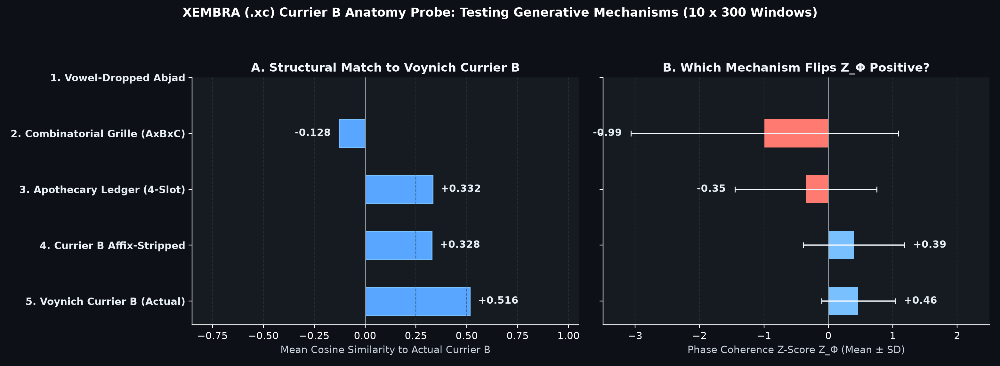

# Currier B Anatomy Probe: What Generative Mechanism Matches Currier B?

Tests four candidate generative mechanisms against actual **Voynich Currier B** across **10 independent 300-token windows** (`30` Monte Carlo shuffles/window, `seed=42`).

| Mechanism | Wins | $Z_c$ (`Mean ± SD`) | $Z_s$ (`Mean ± SD`) | $Z_\Phi$ (`Mean ± SD`) | `cos(Currier B)` |
| :--- | :---: | :---: | :---: | :---: | :---: |
| **1. Vowel-Dropped Abjad** | `10` | `-5.41 ± 3.92` | `+6.60 ± 4.50` | `-0.68 ± 1.73` | `+0.2815` |
| **2. Combinatorial Grille (AxBxC)** | `10` | `+0.43 ± 1.35` | `-0.34 ± 1.17` | `-0.64 ± 1.63` | `-0.0431` |
| **3. Apothecary Ledger (4-Slot)** | `10` | `-1.00 ± 0.52` | `+6.87 ± 1.98` | `-0.35 ± 0.92` | `+0.3954` |
| **4. Currier B Affix-Stripped** | `10` | `-0.66 ± 1.22` | `+0.68 ± 1.16` | `+0.42 ± 0.87` | `+0.2621` |
| **5. Voynich Currier B (Actual)** | `10` | `-0.47 ± 0.94` | `+0.43 ± 0.97` | `+0.33 ± 0.68` | `+0.3890` |
