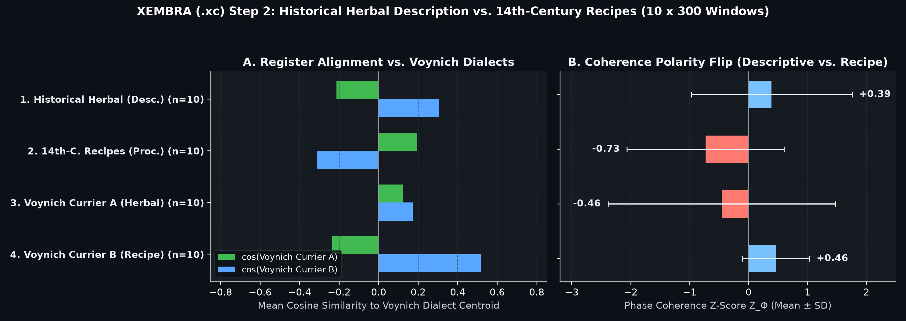

# Step 2: Single-Source Dual-Register Control (Historical Herbal vs. 14th-Century Recipes)

Tests whether authentic historical **descriptive herbal entries** (*Culpeper's Complete Herbal*, PG #49513) vs. **procedural compounding recipes** (*The Forme of Cury*, c. 1390, PG #8102) reproduce the same $Z_\Phi$ polarity flip seen between **Voynich Currier A** and **Voynich Currier B** across **10 non-overlapping 300-token windows** (`30` Monte Carlo shuffles/window, `seed=42`).

| Corpus | Wins | $Z_c$ (`Mean ± SD`) | $Z_s$ (`Mean ± SD`) | $Z_\Phi$ (`Mean ± SD`) | `cos(Currier A)` | `cos(Currier B)` |
| :--- | :---: | :---: | :---: | :---: | :---: | :---: |
| **1. Historical Herbal (Desc.)** | `10` | `-0.16 ± 0.73` | `+0.44 ± 0.65` | `+0.39 ± 1.37` | `-0.2128` | `+0.3050` |
| **2. 14th-C. Recipes (Proc.)** | `10` | `+0.31 ± 0.83` | `+0.25 ± 0.82` | `-0.73 ± 1.33` | `+0.1957` | `-0.3125` |
| **3. Voynich Currier A (Herbal)** | `10` | `-0.39 ± 1.51` | `+0.39 ± 1.43` | `-0.46 ± 1.93` | `+0.1212` | `+0.1728` |
| **4. Voynich Currier B (Recipe)** | `10` | `-0.48 ± 1.01` | `+0.49 ± 0.99` | `+0.46 ± 0.57` | `-0.2350` | `+0.5158` |
