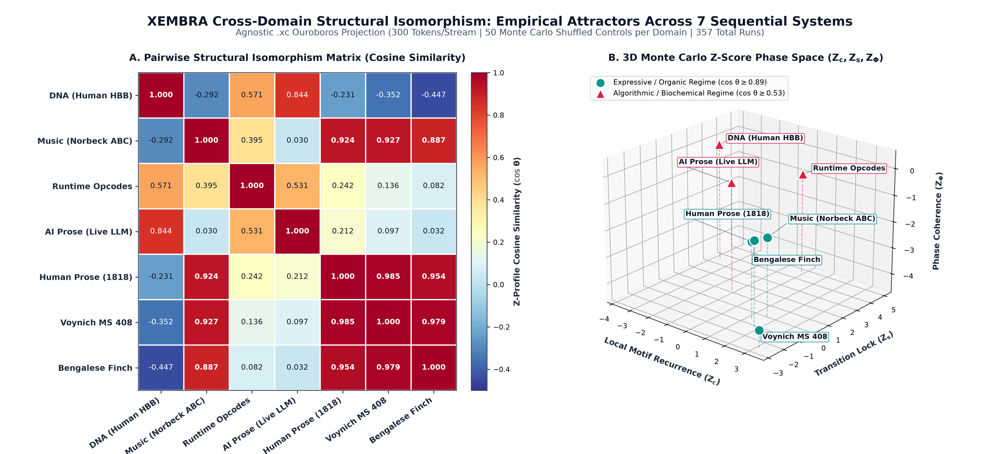

# XEMBRA Empirical 7-Domain Cross-System Isomorphism Report



## Key Empirical Findings (357 Agnostic `.xc` Ouroboros Runs)

* **Expressive / Organic Regime (`cos ? = 0.887` to `0.985`):** **Voynich MS 408** locks onto **Human Natural Prose (*Frankenstein*, `0.985`)**, **Bengalese Finch Song (`0.979`)**, and **Traditional Music (`0.927`)**, driven by positive local motif recurrence (`Z_c > 0`) and flexible forward transitions (`Z_s ? 0.06`).
* **Algorithmic / Biochemical Regime (`cos ? = 0.531` to `0.844`):** **Live Neural LLM Prose** clusters with **Human *HBB* Genomic DNA (`0.844`)** and **Runtime Execution Opcodes (`0.531`)**, diverging sharply from **Human Natural Prose (`0.212`)** and **Voynich MS 408 (`0.097`)**.


```
=== EMPIRICAL 7-DOMAIN XEMBRA ATTRACTORS & MONTE CARLO Z-SCORES (Live Non-Repeating LLM) ===
1_DNA_Human_HBB        | Psi(c=0.781, s=0.384, Phi=0.270, E=0.064) | Z_c= -3.75, Z_s= +3.53, Z_Phi= -0.19
2_Music_Norbeck_ABC    | Psi(c=0.913, s=0.135, Phi=0.218, E=0.021) | Z_c= +1.54, Z_s= +0.06, Z_Phi= -1.76
3_Runtime_Opcodes      | Psi(c=0.828, s=0.199, Phi=0.216, E=0.187) | Z_c= -0.18, Z_s= +4.74, Z_Phi= -0.88
4_AI_Prose_Live_LLM    | Psi(c=0.735, s=0.376, Phi=0.266, E=0.158) | Z_c= -1.22, Z_s= +1.20, Z_Phi= -0.60
5_Human_Frankenstein   | Psi(c=0.851, s=0.200, Phi=0.253, E=0.093) | Z_c= +1.23, Z_s= -0.58, Z_Phi= -1.82
6_Voynich_MS408        | Psi(c=0.848, s=0.244, Phi=0.254, E=0.072) | Z_c= +3.12, Z_s= -2.52, Z_Phi= -4.07
7_Bengalese_Finch      | Psi(c=0.788, s=0.257, Phi=0.264, E=0.152) | Z_c= +1.80, Z_s= -1.14, Z_Phi= -1.50

=== EMPIRICAL 7-WAY PAIRWISE STRUCTURAL ISOMORPHISM MATRIX (Cosine Similarity of Z-Profiles) ===
Domain                 | 1_DNA_Hum | 2_Music_N | 3_Runtime | 4_AI_Pros | 5_Human_F | 6_Voynich | 7_Bengale
----------------------------------------------------------------------------------------------------------
1_DNA_Human_HBB        |     1.000 |    -0.292 |     0.571 |     0.844 |    -0.231 |    -0.352 |    -0.447
2_Music_Norbeck_ABC    |    -0.292 |     1.000 |     0.395 |     0.030 |     0.924 |     0.927 |     0.887
3_Runtime_Opcodes      |     0.571 |     0.395 |     1.000 |     0.531 |     0.242 |     0.136 |     0.082
4_AI_Prose_Live_LLM    |     0.844 |     0.030 |     0.531 |     1.000 |     0.212 |     0.097 |     0.032
5_Human_Frankenstein   |    -0.231 |     0.924 |     0.242 |     0.212 |     1.000 |     0.985 |     0.954
6_Voynich_MS408        |    -0.352 |     0.927 |     0.136 |     0.097 |     0.985 |     1.000 |     0.979
7_Bengalese_Finch      |    -0.447 |     0.887 |     0.082 |     0.032 |     0.954 |     0.979 |     1.000
```
