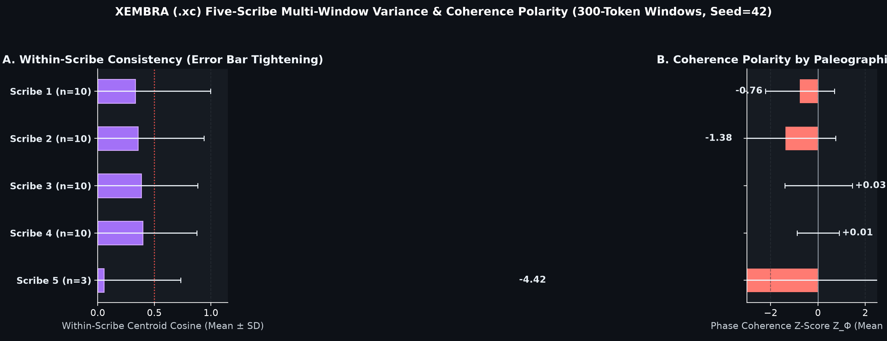

# Five-Scribe Multi-Window Variance & Polarity Benchmark

Evaluates up to **10 non-overlapping 300-token windows per paleographic scribe** (`30` Monte Carlo shuffles per window, `seed=42`) to test whether within-scribe variance tightens relative to mixed byte-offset slicing (`±0.50`–`±0.60`).

| Scribe | Total Toks | Wins | Self-Cosine (`Mean ± SD`) | $Z_c$ (`Mean ± SD`) | $Z_s$ (`Mean ± SD`) | $Z_\Phi$ (`Mean ± SD`) | `cos(Scribe 1)` | `cos(Scribe 2)` |
| :--- | :---: | :---: | :---: | :---: | :---: | :---: | :---: | :---: |
| **Scribe 1** | `12509` | `10` | `+0.333 ± 0.664` | `+0.49 ± 1.07` | `-0.34 ± 1.15` | `-0.76 ± 1.46` | `+0.3327` | `+0.2093` |
| **Scribe 2** | `11825` | `10` | `+0.356 ± 0.583` | `+0.43 ± 1.83` | `-0.48 ± 1.81` | `-1.38 ± 2.13` | `+0.2542` | `+0.3557` |
| **Scribe 3** | `11591` | `10` | `+0.385 ± 0.498` | `-0.74 ± 1.41` | `+0.69 ± 1.24` | `+0.03 ± 1.42` | `-0.3484` | `-0.2177` |
| **Scribe 4** | `3140` | `10` | `+0.398 ± 0.478` | `-0.63 ± 1.08` | `+0.49 ± 0.93` | `+0.01 ± 0.89` | `-0.3627` | `-0.2809` |
| **Scribe 5** | `1143` | `3` | `+0.055 ± 0.677` | `+1.48 ± 2.91` | `-0.59 ± 2.12` | `-4.42 ± 6.95` | `+0.0671` | `-0.0675` |
