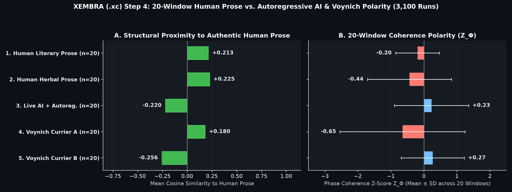

# Step 4: 20-Window Human Prose vs. Autoregressive AI & Voynich Polarity Benchmark

Evaluates **20 independent non-overlapping 300-token windows per corpus** (`100` real windows + `3,000` Monte Carlo shuffle controls = `3,100` `Ouroboros` runs, per-window isolated SHA-256 seeds from `seed=42`).

| Corpus | Wins | $Z_c$ (`Mean ± SD`) | $Z_s$ (`Mean ± SD`) | $Z_\Phi$ (`Mean ± SD`) | `cos(Human Prose)` |
| :--- | :---: | :---: | :---: | :---: | :---: |
| **1. Human Literary Prose (n=20)** | `20` | `-0.05 ± 0.88` | `+0.12 ± 0.99` | `-0.20 ± 0.66` | `+0.2131` |
| **2. Human Herbal Prose (n=20)** | `20` | `+0.13 ± 0.83` | `+0.12 ± 0.80` | `-0.44 ± 1.27` | `+0.2254` |
| **3. Live AI + Autoreg. (n=20)** | `20` | `-0.42 ± 0.91` | `+0.53 ± 0.94` | `+0.23 ± 1.12` | `-0.2199` |
| **4. Voynich Currier A (n=20)** | `20` | `-0.48 ± 1.46` | `+0.43 ± 1.34` | `-0.65 ± 1.89` | `+0.1799` |
| **5. Voynich Currier B (n=20)** | `20` | `-0.16 ± 1.00` | `+0.16 ± 1.08` | `+0.27 ± 0.96` | `-0.2561` |
