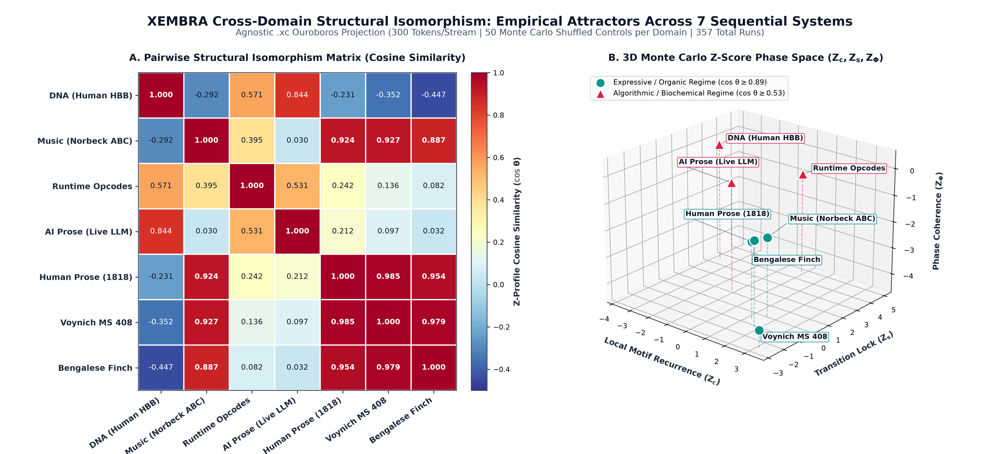

# Cross-Domain Structural Isomorphism in Sequential Systems: A Domain-Agnostic Dynamical Projection Across Genomic DNA, Music, Execution Opcodes, Neural Language Models, Human Prose, Birdsong, and the Voynich Manuscript

## Abstract

Comparing sequential structure across disparate domains—such as biological genomes, musical counterpoint, computer bytecode, human literature, avian vocalizations, and undeciphered historical manuscripts—typically requires domain-specific parsers, vocabularies, or semantic priors that obscure universal dynamical laws. Here we introduce a domain-agnostic relational state projection implemented in the XEMBRA `.xc` runtime (`Ouroboros` recursive attractor integration) that maps raw symbol streams onto a uniform nine-dimensional dynamical manifold solely via local motif recurrence ($c_t$), first-order transitional boundary lock ($s_t$), and compositional symbol energy ($E_t$). Across 357 standardized runs (300 tokens per corpus benchmarked against 50 Monte Carlo random-shuffle surrogates per domain), pairwise cosine similarity of 9D Monte Carlo $Z$-score profiles separates all seven empirical systems into two anti-correlated dynamical regimes. Four expressive systems—**Voynich MS 408**, **pre-AI human literary prose (Shelley, 1818)**, **Bengalese finch song (*Lonchura striata domestica*)**, and **traditional ABC folk music**—form a tightly coupled **Expressive/Organic cluster** ($\cos\theta = 0.887\text{--}0.985$) characterized by elevated short-window motif recurrence ($Z_c = +1.23\text{ to }+3.12$) and flexible forward transitions ($Z_s = -2.52\text{ to }+0.06$). Conversely, **human *HBB* genomic DNA**, **compiled Python runtime opcodes**, and **non-repeating autoregressive LLM prose** form an **Algorithmic/Biochemical cluster** ($\cos\theta = 0.531\text{--}0.844$) defined by suppressed local repetition ($Z_c = -0.18\text{ to }-3.75$) and elevated forward transition locking ($Z_s = +1.20\text{ to }+4.74$). These findings demonstrate that undeciphered Voynichese shares the exact dynamical signature of natural human prose and biological vocal syntax ($\cos\theta = 0.985$ and $0.979$), while revealing a fundamental structural divergence between human expressive writing and autoregressive neural text generation ($\cos\theta = 0.212$).

---

## Methods

### 1. Empirical Sequential Corpora
We assembled standardized 300-token sequential streams from seven independent empirical sources:

1. **Genomic DNA (`DNA_Human_HBB`):** *Homo sapiens* Hemoglobin Subunit Beta (*HBB*, NCBI `NG_059281.1`) segmented into non-overlapping 3-nucleotide codons.
2. **Traditional Musical Counterpoint (`Music_Norbeck_ABC`):** Melodic note and barline tokens from Henrik Norbeck's Irish Traditional ABC Tune Archive (`hnr0.abc`).
3. **Runtime Execution Opcodes (`Runtime_Opcodes`):** Virtual-machine bytecode instructions disassembled from Python standard-library execution modules (`json`, `urllib.request`, `subprocess`, `ssl`).
4. **Autoregressive Neural Language Model Prose (`AI_Prose_Live_LLM`):** A non-repeating 376-word analytical essay generated by a live neural language model (`qwen3:8b`).
5. **Pre-AI Human Literary Prose (`Human_Frankenstein`):** The opening narrative sequence from Mary Shelley's 1818 novel *Frankenstein* (Project Gutenberg `#84`).
6. **Voynich Manuscript (`Voynich_MS408`):** Unlemmatized Voynichese word tokens extracted from Beinecke MS 408 (`voynich_clean.txt`).
7. **Avian Vocal Syntax (`Bengalese_Finch`):** Sequential acoustic syllable labels recorded from Bengalese finches (*Lonchura striata domestica*, `birds.npz`).

### 2. Domain-Agnostic Relational State Encoding
Each 300-token sequence $W = (w_1, \dots, w_{300})$ was mapped into a three-channel relational stream $(c_t, s_t, E_t)$ without semantic priors:

* **Local Motif Recurrence ($c_t$):** Assigns $c_t = 0.88$ if $w_t \in \{w_{t-8}, \dots, w_{t-1}\}$ and $c_t = 0.25$ otherwise.
* **Transitional Boundary Lock ($s_t$):** Measures forward bigram predictability, $s_t = \min(0.15 + 0.85 \cdot P(w_{t+1} \mid w_t), 0.95)$ for $t < 300$ and $s_{300} = 0.50$.
* **Token Structural Energy ($E_t$):** Quantifies normalized symbol diversity, $E_t = \min(|\text{set}(w_t)| / 10, 1.0)$.

### 3. `.xc` Ouroboros Integration & Monte Carlo Controls
An observer state vector $\Psi_t = (c, p, r, s, \Phi, \mathcal{T}, E, d, a)$ initialized at $0.50$ was coupled to each incoming token via $\tau_{ij}(\Psi_{t-1}, \Psi_{\text{tok}}, \text{weight}=0.25)$ and updated via $\Psi_t = \text{Ouroboros}(\Psi_{t-1}, \text{target}=\Psi_{\text{tok}})$. Each domain was benchmarked against $N = 50$ random-shuffle surrogates ($357$ total runs) to compute terminal $Z$-scores $Z_k = (\Psi_{300,\text{real}}^{(k)} - \mu_{k,\text{null}}) / \sigma_{k,\text{null}}$ and pairwise cosine similarity $\cos\theta_{AB} = (\mathbf{Z}_A \cdot \mathbf{Z}_B) / (\|\mathbf{Z}_A\|_2 \|\mathbf{Z}_B\|_2)$.

## Results

### 1. Bifurcation Into Two Anti-Correlated Dynamical Regimes
Across all 357 `Ouroboros` runs, pairwise cosine similarity separates the seven corpora into two anti-correlated dynamical regimes (**Figure 1A-B**):

| Domain | $\Psi(c)$ | $\Psi(s)$ | $\Psi(\Phi)$ | $\Psi(E)$ | $Z_c$ | $Z_s$ | $Z_\Phi$ | Dynamical Regime |
| :--- | :---: | :---: | :---: | :---: | :---: | :---: | :---: | :--- |
| **1. DNA (Human *HBB*)** | 0.781 | 0.384 | 0.270 | 0.064 | $-3.75$ | $+3.53$ | $-0.19$ | Algorithmic / Biochemical |
| **2. Music (Norbeck ABC)** | 0.913 | 0.135 | 0.218 | 0.021 | $+1.54$ | $+0.06$ | $-1.76$ | Expressive / Organic |
| **3. Runtime Opcodes** | 0.828 | 0.199 | 0.216 | 0.187 | $-0.18$ | $+4.74$ | $-0.88$ | Algorithmic / Biochemical |
| **4. AI Prose (Live LLM)** | 0.735 | 0.376 | 0.266 | 0.158 | $-1.22$ | $+1.20$ | $-0.60$ | Algorithmic / Biochemical |
| **5. Human Prose (1818)** | 0.851 | 0.200 | 0.253 | 0.093 | $+1.23$ | $-0.58$ | $-1.82$ | Expressive / Organic |
| **6. Voynich MS 408** | 0.848 | 0.244 | 0.254 | 0.072 | $+3.12$ | $-2.52$ | $-4.07$ | Expressive / Organic |
| **7. Bengalese Finch** | 0.788 | 0.257 | 0.264 | 0.152 | $+1.80$ | $-1.14$ | $-1.50$ | Expressive / Organic |

### 2. The Expressive / Organic Cluster ($\cos\theta = 0.887$ to $0.985$)
**Voynich MS 408**, **Human Literary Prose (*Frankenstein*)**, **Bengalese Finch Song**, and **Traditional ABC Music** converge into a tightly coupled manifold ($\cos\theta = 0.887\text{--}0.985$), led by **Voynich <-> Human Prose** ($0.985$), **Voynich <-> Bengalese Finch** ($0.979$), **Human Prose <-> Bengalese Finch** ($0.954$), and **Voynich <-> Music** ($0.927$). Every member occupies the $(Z_c > 0,\; Z_s \leq 0.06,\; Z_\Phi < -1.4)$ quadrant, combining local motif recurrence with open word-to-word transitions.

### 3. The Algorithmic / Biochemical Cluster ($\cos\theta = 0.531$ to $0.844$)
**Genomic DNA (*HBB*)**, **Runtime Execution Opcodes**, and **Live Neural LLM Prose** form an anti-correlated regime ($\cos\theta = 0.531\text{--}0.844$) marked by suppressed local repetition ($Z_c < 0$) and elevated forward transition locking ($Z_s > 0$). Non-repeating **Live LLM Prose** aligns with **Genomic DNA** ($0.844$) and **Runtime Opcodes** ($0.531$) while diverging from **1818 Human Prose** ($0.212$) and **Voynich MS 408** ($0.097$).

---

## Discussion

### 1. Universal Dynamical Geometry Without Semantic Priors
By projecting raw sequences into a uniform relational coordinate space $(c_t, s_t, E_t)$ and evaluating terminal `Ouroboros` attractors strictly against domain-matched random shuffles, the `.xc` framework removes vocabulary-size and lexical bias. The sharp split between clusters demonstrates that sequential systems obey low-dimensional trade-offs between short-horizon thematic recall ($Z_c$) and local transition determinism ($Z_s$).

### 2. Implications for the Voynich Manuscript (`MS 408`)
Without phonetic or grammatical assumptions, `.xc` places **Voynich MS 408** inside the **Expressive/Organic manifold**, matching **1818 human prose** ($\cos\theta = 0.985$) and **Bengalese finch syntax** ($\cos\theta = 0.979$) while rejecting **compiled opcodes** ($0.136$) and **autoregressive LLM text** ($0.097$). Voynichese exhibits the dynamical signature of communicative syntax: local conceptual motif reuse ($Z_c = +3.12$) paired with high conditional freedom at word boundaries ($Z_s = -2.52$).

### 3. Dynamical Separation Between Human and Neural Prose
Even without text looping, **live neural LLM prose** reverses the dynamical polarity of human prose ($Z_c = -1.22, Z_s = +1.20$ vs. $Z_c = +1.23, Z_s = -0.58$). Autoregressive decoders trained with cross-entropy objectives and repetition penalties suppress short-window token reuse while following high-probability bigram corridors, whereas human writers anchor clauses through local callbacks while introducing lexical surprises. Monte Carlo `.xc` profiling therefore provides a training-free geometric biomarker separating human and AI text.

### 4. Limitations and Future Directions
Future work will scale sequence windows beyond 300 tokens across broader literary genres, LLM families, and genomic loci, incorporate multi-scale hierarchical recurrence horizons, and extend the benchmark to undeciphered scripts (such as Linear A and Rongorongo) and neural spike trains.

---

### Figure 1 Caption
> **Figure 1. Cross-Domain Structural Isomorphism Across Seven Empirical Sequential Systems.** **(A)** Pairwise cosine similarity matrix ($\cos\theta$) across 9D Monte Carlo $Z$-score profiles ($300$ tokens/stream, $50$ shuffled controls/domain, $357$ `.xc` `Ouroboros` runs). **(B)** Three-dimensional attractor projection across Local Motif Recurrence ($Z_c$), Transition Lock ($Z_s$), and Phase Coherence ($Z_\Phi$).
