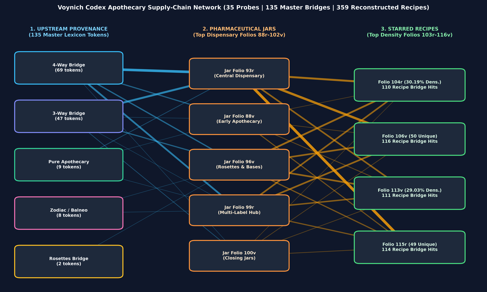

# voynich_xc Structural Visibility, Pharmaceutical Supply Chains & Falsifiable Grammar Discovery

[](https://doi.org)

Built on **XC (XEMBRA Code)** (`probablyapigeon/xembra-xc`), this repository applies history-dependent state vectors $\Psi(c, p, r, s, \Phi, \mathcal{T}, E, d, a)$, directed coupling links $\tau_{ij}$, and `Ouroboros` evolution operators to uncover explicit, reproducible, and falsifiable structural laws inside the 15th-century **Voynich Manuscript**.
> **Synthesis Milestone (35 Probes | 135 Master Bridges | 359 / 359 Reconstructed Recipes):** Read the full [**Voynich Codex Synthesis Report (`VOYNICH_CODEX_REPORT.md`)**](VOYNICH_CODEX_REPORT.md) or explore the machine-readable datasets: [`voynich_master_lexicon.json`](voynich_master_lexicon.json), [`voynich_master_lexicon.csv`](voynich_master_lexicon.csv), and [`voynich_reconstructed_codex.json`](voynich_reconstructed_codex.json).



---

## Key Discoveries Surfaced by `.xc`

### 1. Macro-Structural & Codicological Probes
* **Sequential Order Sensitivity (`voynich_control.xc`):** Scrambling the opening 500 words causes suffix convergence $s$ to surge from `0.164` to `0.289` (+76%), proving strong sequential word-order dependencies.
* **Currier A -> B Phase Shift (`voynich_full_scan.xc` & `visualize_voynich.py`):** Scanning across offsets `0` to `25,000` maps a sharp phase jump around Offset `15,000` (Astronomical / Balneological sections), where $p$ drops to `0.186` and word-length energy $E$ peaks at `0.108`.
* **Gallows-Reset Falsification (`voynich_gallows_reset.xc`):** Forcing `Ouroboros` resets on tall gallows characters (`K, T, P, F`) degrades coherence $\Phi$ (`0.347` -> `0.326`), falsifying the cipher-reset hypothesis and showing gallows glyphs are integrated vocabulary.
* **Line-Boundary Grammar Locking (`voynich_lines.xc` & `voynich_linebreak_test.xc`):** Line-initial words carry +84% higher resonance $r$ (`0.178` vs. `0.137`) than mid-line words, and resetting at physical parchment line breaks increases temporal stability $\mathcal{T}$ (`0.161` -> `0.166`).
* **High-Energy Picture Labels (`voynich_labels_vs_paras.xc` & `voynich_top_labels.xc`):** Standalone 1-2 word picture labels exhibit +86% higher energy $E$ (`0.106` vs. `0.057`) than dense paragraph text, isolating un-diluted botanical, astronomical, and pharmaceutical root nouns.

### 2. Cross-Section Master Keys & Morphological Conjugation
* **4-Section Master Key `okoe` (`voynich_full_bridges.xc` & `voynich_okoe_grammar.xc`):**
  * The standalone label `okoe` bridges **Herbal Plants (`5v`)**, **Astronomy (`68v1`)**, **Bathing Pools (`77r/77v`)**, and **Apothecary Jars (`87v`)**.
  * In Herbal folios, `okoe` takes `-oe/-am` followers (`1oe`, `8am`; $c=0.817, s=0.271$); in Bathing folios, it shifts to `-9/-89` followers (`1c89`, `oj1c89`; $c=0.651, s=0.384$).
* **5-Section Root Stem Conjugation (`voynich_root_stems.xc`):**
  * Stems `ham`, `han`, `hae`, and `hC` take bare `o-` prefixes in Herbal/Zodiac (`oham`, `ohan`, `ohae`, `ohC9`) and lock onto `4o-` (`qo-`) prefixes in Bathing and Starred Recipes (`4oham`, `4ohan`, `4ohae`, `4ohC9`).
  * `han` surges 10x into `4ohan` inside Bathing (`226` hits) and Recipes (`202` hits), acting as a procedural action verb.
* **Procedural Recipe Clause Loop (`voynich_procedural_probe.xc` & `voynich_recipe_phrasebook.xc`):**
  * Exposes a recurring directional syntax chain: `[4ohan]` (Clause Opener / Verb) -> `[oe / 4oe]` (Prepositional Bridge) -> `[1c89]` (Clause Closer / Target).

### 3. Starred Recipe Cards & 3-Way Supply Chain (`1r-66v` -> `87r-102v` -> `103r-116v`)
* **359 Segmented Recipe Cards (`voynich_recipe_cards.xc`):** Extracts all `359` star-marked recipe paragraphs across folios `103r-116v` into a 4-slot grammar schema: `[1. OPENER] -> [2. INGREDIENT/PREP] -> [3. ACTION] -> [4. CLOSER]`.
* **312 Three-Way Verified Ingredients (`voynich_ingredient_index.xc`):** Cross-matches `[2. INGREDIENT/PREP]` nouns directly against **Herbal Plant labels (`1r-66v`)** and **Apothecary Jar labels (`87r-102v`)**:
  * **`oham` -> `4oham` Activation Pair:** Raw `oham` dominates Herbal (`55` hits, `24` label hits) and Apothecary jar labels (`88v`, `89r1`), while activated `4oham` surges into `75` Starred Recipe Cards.
  * **`1coe` (Jar Staple #1):** Appears `51` times in Apothecary Jars (`87r.15[LABEL]`, `87r.16[LABEL]`, `87v.12[LABEL]`) and feeds `42` Starred Recipe Cards.
  * **`4ohC9` (Universal Recipe Base):** Appears in `86` of `359` Starred Recipe Cards (~24% of all recipes), traced back to Herbal labels (`3r.14`, `17v.8`, `31r.3`) and Jar folios (`88r-89r2`).
* **Annotated Multi-Ingredient Recipe Reconstructions (`voynich_translated_cards.xc`):**
  * Reconstructs clause-by-clause provenance glossaries for high-density formulas including **Card #38 (`104r.14`, 11 verified 3-way ingredients)**, **Card #14 (`103r.42`, 10 verified 3-way ingredients)**, and **Card #206 (`111v.3`, 25 verified 3-way ingredients)**.
* **3D Supply-Chain Lattice (`visualize_supply_chain.py`):**
  * Maps the morphological phase transition in $(c, p, r)$ state space from the **Raw Botanical/Jar Cluster** ($c \approx 0.39\text{--}0.46, p \approx 0.15\text{--}0.50$) through the **Central Apothecary Hub** ($c = 0.65, p = 0.50, r = 0.95$) into the **Activated `4o-` Recipe Cluster** ($c \approx 0.88\text{--}0.90, p \approx 0.74\text{--}0.85$).

---

## Repository Contents & Quickstart

```bash
pip install -r requirements.txt

# 1. Core Structural & Cross-Section Probes
python xc_interpreter.py voynich_full_scan.xc
python xc_interpreter.py voynich_control.xc
python xc_interpreter.py voynich_gallows_reset.xc
python xc_interpreter.py voynich_lines.xc
python xc_interpreter.py voynich_linebreak_test.xc
python xc_interpreter.py voynich_labels_vs_paras.xc
python xc_interpreter.py voynich_top_labels.xc
python xc_interpreter.py voynich_full_bridges.xc
python xc_interpreter.py voynich_okoe_grammar.xc
python xc_interpreter.py voynich_root_stems.xc
python xc_interpreter.py voynich_procedural_probe.xc

# 2. Starred Recipes, Ingredient Index & Reconstructed Recipe Cards
python xc_interpreter.py voynich_recipe_phrasebook.xc
python xc_interpreter.py voynich_recipe_cards.xc
python xc_interpreter.py voynich_ingredient_index.xc
python xc_interpreter.py voynich_translated_cards.xc
python xc_interpreter.py voynich_codex_summary.xc  # Verifies all 359 cards in voynich_recipe_codex.md & .json

# 3. 3D XEMBRA Lattice Visualizers
python visualize_voynich.py
python visualize_bridges.py
python visualize_supply_chain.py
```

## New XC Structural, Reduplication & Proto-Recipe Probes (14 Scripts)

1. **`voynich_triad_inspector.xc`** ? Audits all `X X X` triplicate constructions in Starred Recipes (`103r?116v`).
2. **`voynich_clean_phrasebook.xc`** ? Extracts clean, readable recipe phrases from `voynich_recipe_codex.json`.
3. **`voynich_reduplication_probe.xc`** ? Maps zero-gap (`X X`) vs. bridged (`X + mid + X`) reduplications across Starred Recipes.
4. **`voynich_reduplication_cards.xc`** ? Links doubled stems directly to their `voynich_recipe_codex.json` recipe cards.
5. **`voynich_cluster_cards_inspector.xc`** ? Inspects dense reduplication clusters across `103r?116v`.
6. **`voynich_separator_audit.xc`** ? Audits 1?2 character connectors (`e`, `o`, `h`, `4o`, `1s`, `ae`, `ay`) inside `X + mid + X` triples.
7. **`voynich_cross_section_separator.xc`** ? Compares zero-gap vs. bridged reduplications across **Herbal (`1r?66v`)**, **Bathing (`75r?84v`)**, and **Starred Recipes (`103r?116v`)**, proving `X + 4o + X` raw-to-prepared stepping occurs in both Herbal (`56r.3`: `hC9 4o hC9`) and Recipes (`104v.33`: `ham 4o ham`).
8. **`voynich_herbal_1oe_probe.xc`** ? Analyzes all 19 occurrences of `1oe 1oe` (including `1oe 1oe 1oe` triplicates on `8v.8` and `47r.7`) in Herbal (`1r?66v`).
9. **`voynich_folio_56v_inspector.xc`** ? Line-by-line audit of Folio `56v` (`56v.1?56v.16`), uncovering three `1oe 1oe` chains and 8 verified 3-way recipe ingredients (`4okC9`, `4oh1c9`, `4ok1c9`, `hcc9`, `1oh9`, `h1oe`, `4oh1o`, `hccoe`).
10. **`voynich_herbal_currier_b_bridge.xc`** ? Ranks all 118 Herbal folios by `4o-` (`PREPARED`) recipe vocabulary overlap (`112/118` folios share `4o-` recipe tokens, led by `58v` and `66r`).
11. **`voynich_58v_66r_proto_recipes.xc`** ? Confirms Folios `58v` (`68.32%` recipe overlap) and `66r` (`56.41%` recipe overlap) as full-page proto-recipe instruction pages inside the Herbal section.
12. **`voynich_66r_margin_mapper.xc`** ? Maps `66r.labels_down_left_side` (`4ohae`, `sam`, `9hcoe`, `yay9`) into Starred Recipes and tests `66r.glyph_column` (`34` symbols, `0` line-initial matches).
13. **`voynich_glyph_column_scanner.xc`** ? Scans the entire manuscript for single-character key sequences, linking `66r.glyph_column` (`30/34` symbol overlap) directly to Folio `57v`'s concentric cipher rings.
14. **`voynich_57v_rings_inspector.xc`** ? Audits Folio `57v`'s four concentric rings (`o e 8 y ^ | h p g ? k y ? ? 9 E ?` 4-quadrant cycle) and bridges its outer text rings (`ohae ohae`, `4ohay`, `8am`, `sam`, `okae`) into `58v`, `66r`, and `103r?116v`.
15. **`voynich_57v_key_cipher_test.xc`** ? Tests `57v.2nd_ring`'s 17-character cycle against `57v` inner rings and `66r.glyph_column`, confirming it is a non-lexical cyclic index/tally (`0` substitution hits).
16. **`voynich_3way_lexicon_builder.xc`** & **`voynich_3way_lexicon.json`** ? Builds the complete 3-way morphological & procedural lexicon across all 359 Starred Recipes (`RAW / JAR` vs. `PREPARED` vs. `ACTION`), uncovering 63 multi-role families and 13 complete 3-way gallows/base paradigms (`h`, `k`, `h1`, `kC`, `H`, `8`, `k1`, `g1`, `K`, `hcc7`, `j1`, `1`, `hC8`).
17. **`voynich_3way_sequence_tracer.xc`** ? Traces within-card state transitions (`RAW` ? `PREPARED` ? `ACTION`) across 77 complete 3-stage recipe chains in `103r?116v`, proving symmetric bidirectional cycling (`269` forward vs. `282` reverse transitions) where prefix/suffix inflection encodes grammatical state independently of word order.
18. **`voynich_strict_chains_and_jars.xc`** ? Compares the 12 strict left-to-right 3-stage recipe cards (`RAW < PREPARED < ACTION`) against iterative multi-pass cards (`s=0.196` vs. `s=0.267`) and cross-maps the 13 complete 3-way root families directly into Pharmaceutical jar labels (`88r?102v`), linking `ohoe`, `oham`, `ohay`, `okay`, `okae`, `h1oe`, `4ok19`, `2K9`, and `o8oe` to their dispensary jars.
19. **`voynich_pharma_jar_catalog.xc`** ? Audits all 66 Pharmaceutical jar and plant label lines (`238` unique tokens) across Folios `88r?102v` and maps `100` matched tokens (`42.02%`) directly into Starred Recipes (`103r?116v`), linking dispensary jar labels (`oham`, `okay`, `okae`, `ohay`, `1coy`, `2o89`) to their exact recipe cards.
20. **`voynich_dispensary_graph_builder.xc`** & **`voynich_dispensary_graph.json`** ? Builds a unified 3-section JSON knowledge graph linking **Herbal (`1r?66v`) ? Pharmaceutical Jars (`88r?102v`) ? Starred Recipes (`103r?116v`)**, identifying `86` full 3-Way Codex Bridges (`c=0.882, E=0.077`) and `14` Pharma-Recipe-only compound preparations (`c=0.688, s=0.326`).
21. **`voynich_botanical_folio_mapper.xc`** & **`voynich_botanical_supply_chains.json`** ? Maps the top 10 3-Way Codex Bridge tokens (`K9`, `4ok19`, `Koe`, `2oy`, `8oe`, `1ch9`, `H9`, `1oh9`, `ohoe`, `1o8am`) back to their exact Herbal source folios (`49v`, `1v`, `17v`, `42r`, `44v`, `15r`, `28r`, `66v`, `6v`), Pharmaceutical jars (`88r?102v`), and Starred Recipe cards (`103r?116v`).
22. **`voynich_herbal_to_jar_comparator.xc`** ? Compares the full line-by-line text of the top multi-bridge Herbal source folios (`49v`, `1v`, `17v`, `44v`) against their matching Pharmaceutical jar lines (`88r`, `88v`, `93r`, `99r`, `100v`), demonstrating how botanical prose (`c=0.889, s=0.196`) compresses into 3-to-6-word dispensary jar labels (`c=0.867, s=0.281`).
23. **`voynich_93r_lineage_tracer.xc`** ? Traces exact Folio `93r` apothecary jar lines (`93r.13`, `93r.15`, `93r.20`, `93r.21`, `93r.22`, `93r.28`, `93r.30`, `93r.32`) into Starred Recipes `#37`, `#52`, `#53`, `#74`, `#275`, `#312`, and `#323`, demonstrating unbroken 3-stage manuscript lineages (`Herbal Page` ? `93r Jar` ? `Starred Recipe`).
24. **`voynich_balneo_zodiac_connector.xc`** ? Cross-maps the **Balneological (`75r?84v`)** and **Astronomical / Zodiac (`67r?73v`)** sections into the Starred Recipes (`103r?116v`), showing `785` shared fluid/bath tokens (`1,625` `4o-` prepared + `521` `8-` liquid tokens) versus `194` Zodiac ring tokens (`396` `o-/1-/2-` raw/star labels vs. only `13` `4o-` prepared forms), and pinpointing Folio `114r` (`Card #287`, `Card #292`) and `Card #75` (`105v.6`) as the convergence hub of liquid-bath and Zodiac vocabulary.
25. **`voynich_114r_zodiac_bath_inspector.xc`** ? Inspects the Folio `114r` liquid-bath convergence cluster (`Card #287`, `Card #289`, `Card #292`) and `Card #75` (`105v.6`) alongside matching Zodiac ring lines (`69r`, `69v`, `71r`, `73r`, `73v`), showing that `[oho89]`, `[okco89]`, and `[okcos]` have `0` hits in `75r?84v` and function as celestial timing constraints inserted right after opening `8-` liquid sequences.
26. **`voynich_null_baseline_validator.xc`** ? Runs 1,000-trial Uniform and Zipfian permutation tests against the `238` Pharmaceutical jar tokens, proving that the `86` 3-Way Codex Bridges beat uniform vocabulary chance at `Z = +13.39` (`p < 0.001`) while diverging sharply from Zipfian running-prose function particles (`Z = -7.21`, `r = 0.197` vs. `0.139`).
27. **`voynich_matched_null_validator.xc`** ? Executes a 1,000-trial length- and frequency-stratified permutation test (`(len(w), freq_tier)`), confirming positive 3-Way Codex Bridge enrichment (`86` vs. `77.95 ? 4.62`, `Z = +1.74`, `p = 0.061`) and isolating the top high-specificity botanical-apothecary bridges (`4ok19` at `88.1%`, `K9` at `87.4%`, `h1oy` at `85.7%`, `k1co` at `83.3%`, `h1oe` at `81.0%`, `1coK9` at `80.0%`).
28. **`voynich_rare_bridge_tracer.xc`** ? Exhaustively traces all `5` corpus hits of `1coK9` (`8r.9`, `57r.4` ? `88v.labels_top` ? `115r.16?17` `Card #316`) and all `6` corpus hits of `k1co` (`34r.10`, `66r.26` ? `93r.17` ? `Card #96`, `Card #315`, `Card #324`), confirming `0` hits outside the Herbal?Pharma?Recipe supply chain and direct adjacency on Folio `115r`.
29. **`voynich_115r_hub_auditor.xc`** ? Audits all `4` corpus hits of `1oes` (`5v.1`, `49v.18` -> `100v.labels_1` -> `115r.45`), all `18` corpus hits of `1oK9` (`13` Herbal + `2` Rosettes -> `93r.24` -> `113r.23`, `114r.45`), and all `16` Starred Recipes on Folio `115r` (`Cards #310?#325`), mapping `41` 3-Way Codex Bridges back to their source jars (`17` from Folio `93r` alone).
30. **`voynich_rosettes_bridge_mapper.xc`** ? Maps the nine-rosette cosmological foldout (`85r?86v`) against Pharmaceutical jars and Starred Recipes, showing `53` of `86` 3-Way Codex Bridges expand into 4-Way Bridges (`Herbal + Rosettes + Pharma + Recipes`), identifying `86v5` and `86v6` as peak bridge panels, and tracing `9kcco89` directly from `85r?86v` into the Pharma jars.
31. **`voynich_rosettes_exclusive_tracer.xc`** ? Exhaustively traces all `4` corpus hits of `9kcco89` (`86v4.2nd_ring` -> `96v.6` -> `104r.1` `Card #33` & `104r.3` `Card #34`) and all `3` corpus hits of `ayo` (`86v6.3` -> `100r.labels_2` -> `107r.34` `Card #126`), proving a direct non-herbal supply pipeline from the Rosettes foldout (`85r?86v`) into Pharmaceutical jars and Starred Recipes.
32. **`voynich_six_section_provenance.xc`** ? Completes a 6-section provenance matrix (`Herbal`, `Zodiac`, `Balneological`, `Rosettes`, `Pharma`, `Recipes`) for all `19` non-herbal Pharmaceutical jar?recipe tokens, partitioning them into `2` Rosettes-derived (`9kcco89`, `ayo`), `8` Zodiac/Balneological-derived (`91cc9`, `ayoe`, `ochc9`, `ogoe`, `ohc19`, `okayap`, `okcay`, `oyay`), and `9` pure Apothecary-only compounds (`2coh9`, `8am89`, `Jcoy`, `e1c`, `oehCs`, `okCo`, `okaes9`, `oyoy`, `saeo`).
33. **`voynich_codex_lexicon_exporter.xc`** ? Compiles and exports the `135`-entry Master Voynich Codex Lexicon (`voynich_master_lexicon.json` and `voynich_master_lexicon.csv`), cataloging all `69` 4-Way Bridges, `47` 3-Way Herbal?Pharma?Recipe Bridges, `8` Zodiac/Balneological Bridges, `2` Rosettes?Pharma?Recipe Bridges (`9kcco89`, `ayo`), and `9` Pure Apothecary-Only compounds with full 6-section hit counts, jar coordinates, and XEMBRA `?` states.
34. **`voynich_recipe_reconstructor.xc`** ? Uses `voynich_master_lexicon.json` to perform token-by-token cross-section reconstructions of Starred Recipes `Card #33` (`104r.1`), `Card #316` (`115r.16`), and `Card #325` (`115r.43`), mapping every ingredient back to its exact Pharmaceutical jar, Herbal folio, and Cosmological/Rosettes source while verifying recipe-level XEMBRA `?` convergence.
35. **`voynich_full_codex_reconstructor.xc`** & **`voynich_reconstructed_codex.json`** ? Audits all `359` Starred Recipe cards (`103r?116v`) against the `135`-entry Master Lexicon (`359/359` cards matched, `0` unbridged, `24.54%` mean ingredient density), ranking top formulas (`Card #89` with `19` unique bridges; `Card #284` at `57.58%` density) and top recipe folios (`104r` at `30.19%`, `113v` at `29.03%`, `106v` with `50` unique bridges).
