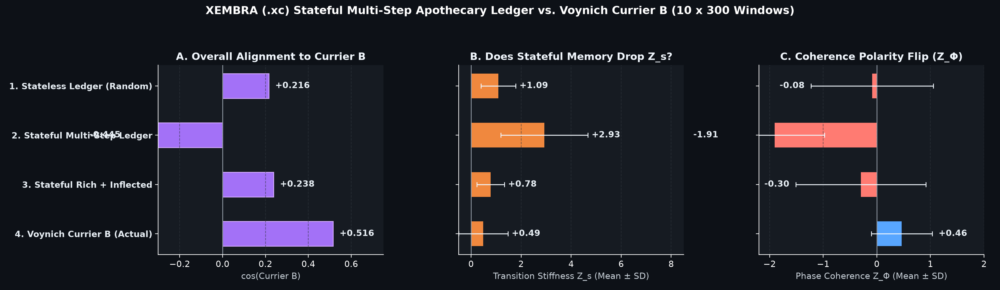

# Stateful Multi-Step Apothecary Ledger Probe

Tests whether holding an active ingredient steady across 4–6 consecutive preparation steps (`Stateful Multi-Step Ledger`) drops bigram stiffness $Z_s$ toward **Voynich Currier B** (`10 x 300` windows, `seed=42`).

| System | Wins | $Z_c$ (`Mean ± SD`) | $Z_s$ (`Mean ± SD`) | $Z_\Phi$ (`Mean ± SD`) | `cos(Currier B)` |
| :--- | :---: | :---: | :---: | :---: | :---: |
| **1. Stateless Ledger (Random)** | `10` | `-0.41 ± 0.65` | `+1.09 ± 0.69` | `-0.08 ± 1.14` | `+0.2157` |
| **2. Stateful Multi-Step Ledger** | `10` | `+0.14 ± 0.35` | `+2.93 ± 1.74` | `-1.91 ± 0.93` | `-0.4453` |
| **3. Stateful Rich + Inflected** | `10` | `-0.37 ± 0.47` | `+0.78 ± 0.55` | `-0.30 ± 1.21` | `+0.2377` |
| **4. Voynich Currier B (Actual)** | `10` | `-0.48 ± 1.01` | `+0.49 ± 0.99` | `+0.46 ± 0.57` | `+0.5158` |
