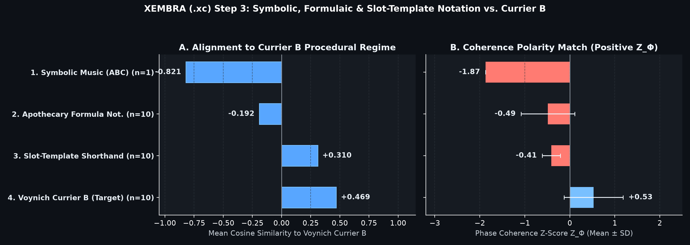

# Step 3: Symbolic, Formulaic & Slot-Template Shorthand Control

Tests **Hypothesis #2** (whether symbolic notation, apothecary formulas, or slot-locked morphological shorthand reproduce **Voynich Currier B's** positive $Z_\Phi = +0.46$ procedural regime, unlike natural English recipes in Step 2 which stayed negative at $Z_\Phi = -0.55$).

| System | Wins | $Z_c$ (`Mean ± SD`) | $Z_s$ (`Mean ± SD`) | $Z_\Phi$ (`Mean ± SD`) | `cos(Voynich Currier B)` |
| :--- | :---: | :---: | :---: | :---: | :---: |
| **1. Symbolic Music (ABC)** | `1` | `+0.48 ± 0.00` | `+0.64 ± 0.00` | `-1.87 ± 0.00` | `-0.8205` |
| **2. Apothecary Formula Not.** | `10` | `-0.06 ± 0.15` | `+0.71 ± 0.64` | `-0.49 ± 0.60` | `-0.1917` |
| **3. Slot-Template Shorthand** | `10` | `-2.58 ± 0.59` | `+3.88 ± 1.03` | `-0.41 ± 0.20` | `+0.3103` |
| **4. Voynich Currier B (Target)** | `10` | `-0.59 ± 1.20` | `+0.52 ± 1.09` | `+0.53 ± 0.65` | `+0.4694` |
